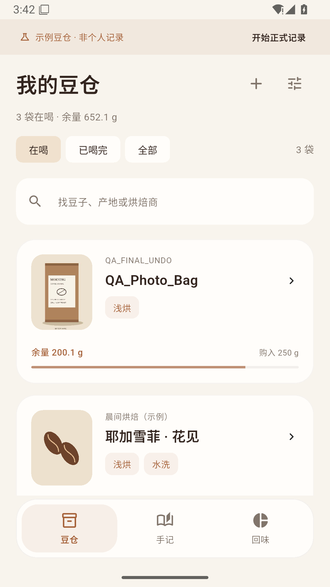
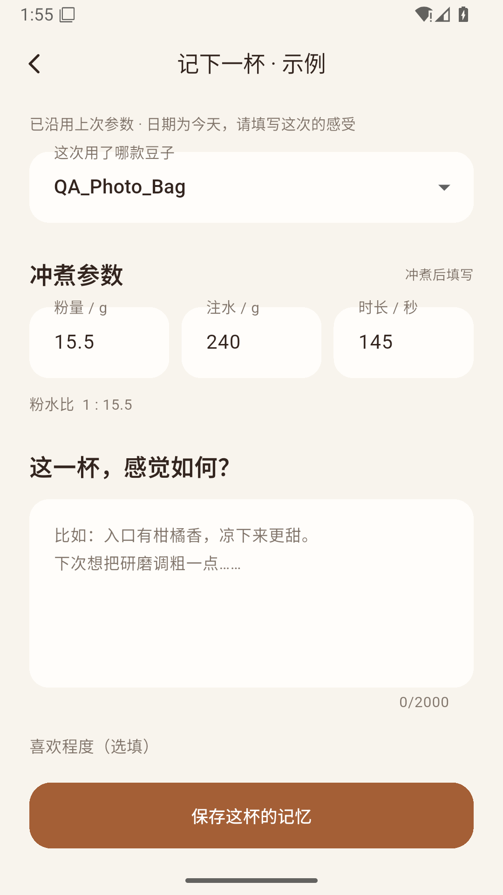
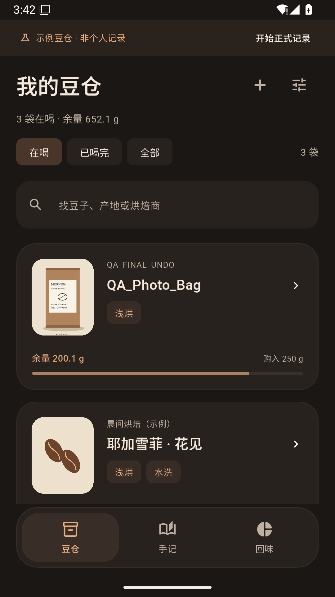

# 咖啡手记 · Coffee Journal

当前版本 **0.3.0+3**。见 [0.3.0 更新说明](docs/v0.3.0.md)、[迁移约定](docs/migration-v0.3.0.md) 与 [本轮验证](docs/validation-v0.3.0.md)。[GitHub Release](https://github.com/yuminhang666-oss/coffee/releases/tag/v0.3.0) 提供安装包、源码归档和校验值。

安装包：[ARM64](https://github.com/yuminhang666-oss/coffee/releases/download/v0.3.0/CoffeeJournal-0.3.0-arm64.apk) · [ARM32](https://github.com/yuminhang666-oss/coffee/releases/download/v0.3.0/CoffeeJournal-0.3.0-arm32.apk) · [SHA-256](deliverables/v0.3.0/SHA256SUMS.txt)。沿用原应用 ID 与 Android Debug 体验签名，支持覆盖安装。

0.3.0 主参数默认显示粉量、注水量、分秒总时长及水温；新增记录不预填温度。资料分开记录产地、生产者、处理站和品种，提供六档烘焙、分组中文风味库和每袋个人六项感官档案。风味与评分选填，沿用参数清空本杯感受，继续离线使用。

以下 0.2.0 内容保留为历史说明，当前数据与交互约定以 0.3.0 文档为准。

豆仓始终是首页。买过的每一袋豆子，和喝完后写下的每一杯感受，都留在本机。

[下载 0.2.0 ARM64 安装包](https://github.com/yuminhang666-oss/coffee/releases/download/v0.2.0/CoffeeJournal-0.2.0-arm64.apk) · [ARM32 兼容包、校验清单与更新说明](https://github.com/yuminhang666-oss/coffee/releases/tag/v0.2.0)

Android 7.0 / API 24 及以上。通常选择 ARM64；旧 ARM32 手机使用兼容包。直接覆盖安装即可从 0.1.0 升级，不必卸载。应用 ID 与签名证书保持不变。仍沿用 0.1.0 的 Android Debug 体验版签名，尚非生产签名。

## 0.2.0

- **豆仓**：缩小顶部概览，以照片、名称、烘焙商、烘焙程度与余量为主。保留在喝、已喝完、全部和搜索；切换标签收起键盘，返回时保留列表位置。浅色、深色和控件使用统一咖啡色系。
- **豆袋照片**：系统选择器添加、更换、移除，详情可缩放看大图。选中后复制进应用私有目录，处理方向并生成 1600 px 原图和 360 px 缩略图。无相册/存储读取权限，无图片上传；无照片使用原创绘制占位图。
- **冲煮后记录**：选择豆子 → 粉量、注水量、总秒数 → 大文本框写感受 → 保存。评分和风味选填；水温、器具、磨豆机和原文研磨刻度默认收在“更多参数”。粉水比自动计算，粉量精确到 0.1 g。
- **沿用上次参数**：豆子档案里可复用该豆子的参数；日期更新为今天，感受、评分、风味、收藏、地点与额外支出重新填写。保存前不增加手记、不扣库存。返回编辑页时可继续编辑或明确放弃。
- **余量校正**：输入实际余量及原因，独立保留时间与调整前后克数，不增加杯数、不改变购豆支出或历史用豆量。历史修改遇到校正时展示计算结果；越界时阻止保存并保留原记录。校正范围为 0–本袋购入重量，同款再次购买仍新增一袋。
- **迁移与完整备份**：显式迁移 schema 1 → 2，迁移前保留原始存档。完整 ZIP v2 包含数据、照片与缩略图；继续恢复 0.1.0 JSON。先校验、再展示豆子/手记/照片数量，确认后替换；设置中可“撤销上次恢复”，找回原记录和相应照片。
- **回味**：保留本月/全部时间的杯数、评分、风味与支出。购豆支出不重复摊入单杯。

首次可空白开始，也可主动选择示例豆仓；示例始终标明。没有实时计时、冲煮步骤、账号、社区、广告、云同步或通知。

## 界面与验证

截图均为模拟器中的主动选择示例和合成 QA 数据；豆袋图片是项目原创的测试包装图，没有个人照片或真实消费记录。

<p>
  
  
  
</p>

实际通过范围、环境、性能数据与限制见 [验证记录](docs/validation.md)。不以模拟器结果承诺所有设备流畅度；尚未在实体手机或 Android 全版本矩阵验收。

## 本机数据与备份限制

完整 ZIP 最大 64 MB（解压总量也为 64 MB），最多 4002 个文件，JSON 最大 5 MB；最多 2000 袋豆子、10000 篇手记、10000 条校正。每张导入备份中的 JPEG 最大 2 MB；系统选择的源图片最大 30 MB / 8000 万像素。版本、路径、重复条目、照片引用与缺失图片均会校验。

照片采用不可变文件；更换或移除不会删除恢复副本仍需的照片。0.2.0 暂不自动清理历史照片，频繁更换会增加本机占用；导出只打包当前豆仓引用的照片。备份未加密。卸载或清除应用数据会丢失本机内容，请定期导出。

## 开发

Flutter 3.47.7 / Dart 3.13.5、JDK 17、Android SDK 36。没有新增第三方运行时依赖、服务或权限。系统图片解码、私有文件与 ZIP 均由 Android 系统 API 完成。

```powershell
flutter analyze --no-pub
flutter test --no-pub
flutter build apk --release --split-per-abi --no-pub
```

本机可 `. ./tools/enter-coffee.ps1` 复用现有 SDK、缓存和临时目录，随后用 `Invoke-CoffeeFlutter` 代替 `flutter`。仅影响当前进程环境。若其他机器需要解析依赖，应由其使用者自行授权。

- [架构、库存、迁移与完整备份](docs/architecture.md)
- [实际验证结果与复现](docs/validation.md)
- [设计取舍与参考来源](docs/design-and-references.md)
