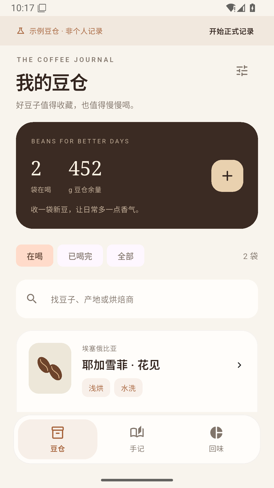
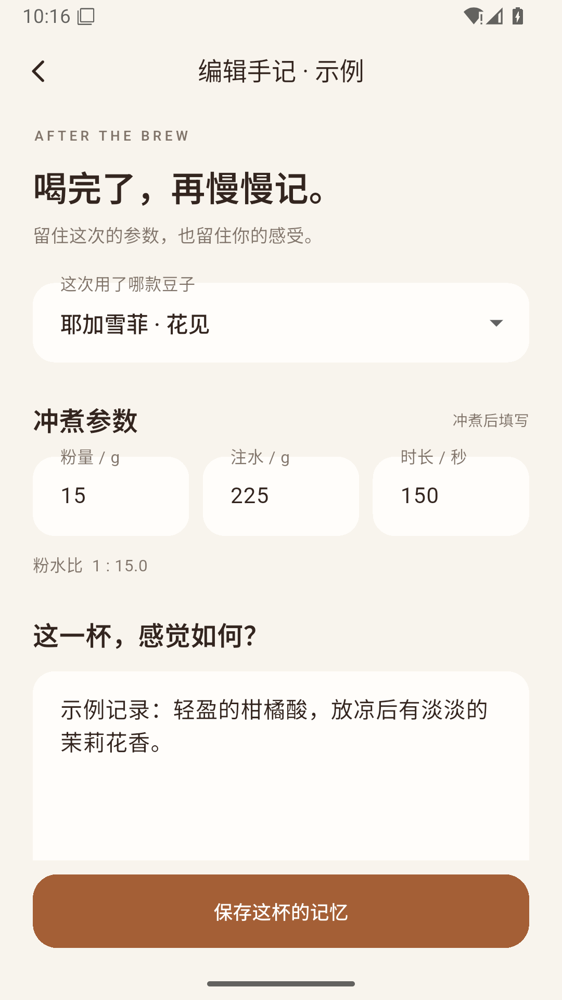
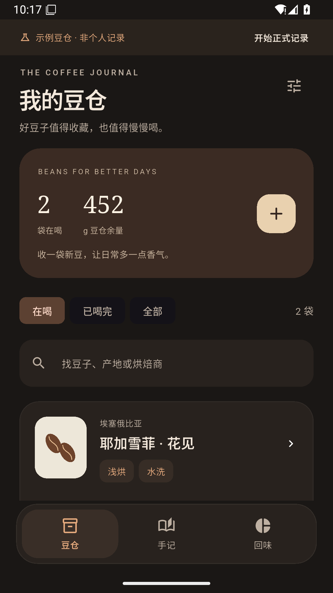

# 咖啡手记 · Coffee Journal

豆仓是首页，冲煮之后再记录。一个无需账号、完全离线的 Android 咖啡小本子。

[下载 ARM64 安卓安装包](https://github.com/yuminhang666-oss/coffee/releases/download/v0.1.0/CoffeeJournal-0.1.0-arm64.apk) · [其他架构与版本说明](https://github.com/yuminhang666-oss/coffee/releases/tag/v0.1.0)

多数现代安卓手机选择 ARM64。Android 7.0 / API 24 及以上。0.1.0 是 release 模式构建、默认 debug 证书签名的体验版，尚未在真实手机验收。

## 现在可以做什么

- **我的豆仓**：记录买过的豆子，包括名称、烘焙商、产地、烘焙程度、处理法、净重、价格、购入日期、烘焙日期和备注。可搜索，区分在喝与已喝完。
- **冲煮后手记**：从豆子档案点“记一杯”，填写粉量（支持 0.1 g）、注水量（g）、总时长（秒），在大文本框写下感受。自动计算粉水比；评分、风味标签、日期、方式和额外支出可选。
- **余量联动**：新增手记扣减用豆量；编辑或删除后重新计算。用豆量不能超过购入量。移除豆子会保留已有手记并解除关联。
- **回味**：按本月或全部时间查看记录杯数、评分、风味标签与支出；最近七天按真实记录显示杯数。购豆支出不重复摊入单杯。
- **本机保存与备份**：无账号、广告和联网权限。JSON 经系统文件选择器导出；恢复前先校验，再确认替换，并保留替换前副本。
- **手感与外观**：奶油浅色、浓咖深色、跟随系统；轻微按压缩放、选择触感、弹性滚动、可拖动的手记面板。尊重系统减少动画设置，保留 Android 返回行为。

没有冲煮中的计时器或实时步骤。首次可空白开始，也可主动选择示例豆仓；示例始终标明，正式记录前可清除示例。

## 界面

所有预览都来自模拟器中的示例/合成测试数据，不是个人消费与咖啡记录。

<p>
  
  
  
</p>

## 开发

Flutter 3.47.7 / Dart 3.13.5，JDK 17，Android SDK 36。Flutter 依赖只有 SDK、本地化和测试/lint 库。Android 桥接使用系统 API，没有新增第三方服务或插件。

```powershell
flutter pub get --offline
flutter analyze --no-pub
flutter test --no-pub
flutter build apk --release --split-per-abi --no-pub
```

本机可 `. ./tools/enter-coffee.ps1` 复用已有工具，随后用 `Invoke-CoffeeFlutter` 代替 `flutter`；仅设置当前进程环境，不安装依赖或改全局设置。其他机器使用自己的 SDK 路径。

- [架构、数据与恢复规则](docs/architecture.md)
- [验证结果与边界](docs/validation.md)
- [设计取舍与参考来源](docs/design-and-references.md)

卸载或清除应用数据会丢失本机内容，请定期导出备份。JSON 备份没有加密。尚无云同步、图片、批次补货、余量校正、磨度/水温字段或通知；后续可以在真实使用反馈后迭代。
